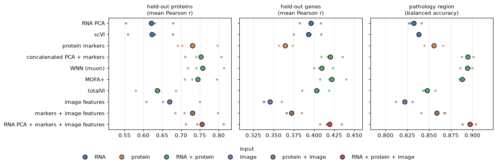

# Joint vs single-modality representations of Xenium RNA + protein

Does modelling RNA and protein jointly describe cells better than either modality alone, and do image features of the
stains add to the mean intensities? On the 10x Xenium Protein FFPE renal cell carcinoma (425,878 cells after QC, 405
genes, 27 proteins), we compare cell representations by how well they predict what they were not trained on.

## Setup

- **Folds.** 3 folds; each holds out 9 of the 27 proteins, a third of the well-detected genes (detected in >= 10% of
  cells, 41 per fold) and a random 20% of the cells as test cells. Every model is fit without the held-out features.
- **Metrics,** computed from each representation with a kNN (k = 20) over the training cells:
  - held-out proteins and genes: mean over features of the Pearson r between the measured values of the test cells
    and the mean of their neighbors (protein log1p z-scores, gene log-normalized expression);
  - pathology region (Tumor vs Immune infiltration, from the pathologist's annotation on the H&E): balanced accuracy
    of the majority vote of the neighbors.
- **Methods** (20 dimensions where there is a choice):
  - RNA: PCA of log-normalized expression; scVI.
  - protein: the z-scored log1p markers.
  - RNA + protein: RNA PCA and markers concatenated, each block scaled to unit total variance; WNN (muon); MOFA+;
    totalVI.
  - image: cp_measure features (intensity, size and shape, texture, granularity, radial distribution;
    `image_features.py`) of the cell shape, the DAPI and the 18 training stains, never of the held-out ones; features
    that record the position of a cell are dropped. They are z-scored and selected with mantispy (pycytominer's steps:
    drop degenerate, constant, mostly missing and correlated features; about 1,300 of 3,000 kept per fold), then
    reduced to 20 principal components. Alone, with the markers, and with RNA PCA and the markers.

## Results (all cells, mean of 3 folds)



| method | input | held-out protein r | held-out gene r | region bal. acc. |
| --- | --- | --- | --- | --- |
| RNA PCA | RNA | 0.621 | 0.396 | 0.832 |
| scVI | RNA | 0.623 | 0.393 | 0.838 |
| protein markers | protein | 0.731 | 0.364 | 0.856 |
| concatenated | RNA + protein | 0.753 | 0.420 | 0.895 |
| WNN | RNA + protein | 0.757 | 0.410 | 0.894 |
| MOFA+ | RNA + protein | 0.745 | 0.422 | 0.888 |
| totalVI | RNA + protein | 0.636 | 0.403 | 0.848 |
| image features | image | 0.670 | 0.345 | 0.822 |
| markers + image features | protein + image | 0.730 | 0.372 | 0.859 |
| RNA PCA + markers + image features | RNA + protein + image | 0.756 | 0.419 | 0.897 |

Per fold and per feature: `results/results_per_fold.csv`, `results/results_per_feature.csv`.

- **Joint beats either modality alone** on all three metrics: RNA and protein carry complementary information about
  a cell, also about its tissue context.
- **Simple joint representations are as good as the models.** Concatenating an RNA PCA with the markers matches WNN
  and MOFA+; the differences between the three are within the spread over folds.
- **Protein predicts protein, RNA predicts genes.** The protein markers alone predict held-out proteins better than
  any RNA representation, and the RNA representations predict held-out genes better than the markers.
- **totalVI is barely better than RNA alone on proteins** (0.636 vs 0.623). It models protein counts with a background component;
  Xenium protein values are background-subtracted mean intensities, which we round to integers to fit it. The model
  is therefore misspecified for this data, and its result should not be read as a verdict on totalVI for CITE-seq.
- **The image features carry information, but little that the mean intensities do not.** From the images of the
  training stains alone, a cell's held-out proteins are predicted better than from any RNA representation (0.670).
  Added to the markers, or to RNA and markers, they change the scores by less than 0.01: a small gain in every fold
  for the held-out genes with the markers (0.002 to 0.011), and for proteins and region with RNA and markers (0.001
  to 0.005), all within the spread over folds.
- On a 50,000-cell subsample the ranking of the first seven methods is the same
  (`results/results_summary_50k_cells.csv`).

### Two pitfalls of the image features

- **Texture needs the image scaled to its range.** cp_measure maps a 16-bit image to 256 gray levels by the full
  dtype range for its texture features; the Xenium stains use a small part of it, so in most cells a stain has one or
  two gray levels and its texture is undefined (77% of the values on a test window). squidpy's
  `calculate_image_features` scales each channel to 0-1 by its 99.9th percentile first (`intensity_range="auto"`,
  from scverse/squidpy#1321; this repository installs that branch). Before the fix, the image features alone scored
  0.540 / 0.274 / 0.749.
- **Median/MAD scaling discards sparse stains.** mantispy's default normalization (`mad_robustize`) is made for
  well-averaged profiles; on single cells most cells are negative for a sparse stain, its MAD is 0, and the selection
  then drops its features (10 of 155 kept for PD-L1, CD20 and granzyme B, against 25 with z-scores). We use
  `method="standardize"`.

## Methods not included

- **MultiVI** models RNA + chromatin accessibility, not protein.
- **MOFA-FLEX** (`mofaflex` 0.1.2) is not an arm: on this data its factors explain the proteins but little of the
  RNA, so it behaves like a protein-only representation. On fold 0 of the 50,000-cell subsample (GPU,
  `mofaflex_retest.py`):

  | setting | protein r | gene r | region bal. acc. | variance explained, RNA / protein |
  | --- | --- | --- | --- | --- |
  | Gaussian, horseshoe weights, lr 0.05, minibatch 5000 | 0.662 | 0.335 | 0.850 | 0.17 / 1.03 |
  | Gaussian, normal weights, PCA init, full batch | 0.671 | 0.345 | 0.846 | 0.16 / 1.22 |
  | Gaussian, horseshoe weights, PCA init, full batch | 0.677 | 0.349 | 0.848 | 0.19 / 1.23 |
  | RNA negative binomial, protein Gaussian | 0.650 | 0.334 | 0.842 | 0.00 / 1.03 |
  | *for comparison:* MOFA+ | 0.706 | 0.397 | 0.883 | |
  | *for comparison:* protein markers | 0.658 | 0.334 | 0.850 | |

  The variance explained is the sum over factors of the per-factor R2 reported by the model (MOFA+ on all cells and
  all features, for reference: 0.31 for the RNA, 0.70 for the protein). MOFA-FLEX centers and
  scales each view to unit variance, as MOFA+ does, so view scaling does not explain the difference. With the negative
  binomial likelihood on the RNA counts, the RNA view is not explained at all.

## Running it

Training runs on a GPU (scVI, totalVI, MOFA+ through cupy); a job without one fails.

```bash
cd benchmark
python prep.py ../data WORK_DIR                    # QC, pathology region per cell, folds (add --n-cells N to subsample)
python image_features.py ../data IMAGES.zarr WORK_DIR/image_features.h5ad   # CPU, 2 h on 64 cores
WORK_DIR=WORK_DIR sbatch slurm_benchmark.sh        # 10 methods x 3 folds, one GPU task each
python evaluate.py WORK_DIR                        # results_*.csv in WORK_DIR
python plot_results.py WORK_DIR/results_per_fold.csv benchmark.png
```

`../data` is filled by `notebooks/helpers.download`. Measured on one A100/H100 with 8 CPU cores and all cells:
scVI and totalVI about 6 min per fold, MOFA+ 2 to 3 min, WNN 8 min (CPU code), the image arms 2 to 5 min. The image
features take 2 hours on 64 CPU cores for all cells (texture and the radial features dominate);
`python -u` shows squidpy's progress bar in a log file.
